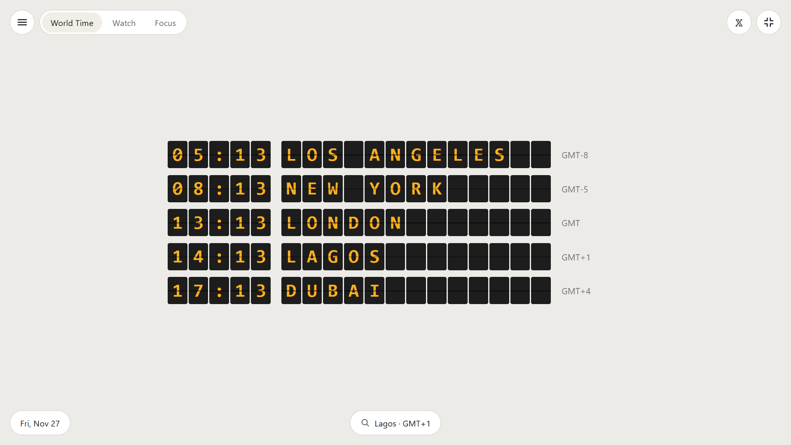

# zoneboard


A split-flap departure board for world time zones: compare cities at a glance.

**Live app:** https://zoneboard-nathani.vercel.app



## Privacy

Your city list and theme choice are saved only in your own browser (`localStorage`). They are never sent to a server, and there are no accounts, cookies or analytics. Clearing your browser's site data resets the board to the default cities.

## Features

- Split-flap board with live 24-hour times and GMT offsets, updated on the minute
- Scramble animation when tiles change; only the tiles that change animate
- Turns the animation off for visitors with **reduce motion** switched on in their system settings
- Search 152 cities by name or country; ignores case and accents ("bogota" finds Bogotá)
- Add up to 8 cities, remove them with ×, and the board is remembered on your next visit
- Summer time and half- or quarter-hour offsets (India, Nepal, Newfoundland) handled by the browser's own time-zone data
- Keyboard and screen-reader friendly: arrow keys, Enter and Esc in search; each row is read as one line ("Lagos: 14:28, GMT+1")
- System / Light / Dark theme switch; your choice is remembered and applied before the page draws, so there's no flash

## Run locally

You need [Node.js](https://nodejs.org) 26.

```
git clone https://github.com/Nathani21/zoneboard.git
cd zoneboard
npm install
npm run dev
```

Then open http://localhost:5173.

## Run tests

```
npm test
```

99 tests with [Vitest](https://vitest.dev). CI runs the tests and a type-checked build on every pull request.

## How it works

The logic is split into small, pure TypeScript modules with no access to the page, so every one of them can be unit-tested:

| File | What it does |
|---|---|
| `src/zones.ts` | Times and offsets for any IANA time zone, using the browser's `Intl` API (no hard-coded offsets) |
| `src/board.ts` | Board rows, character tiles, adding and removing cities |
| `src/scramble.ts` | Which character each tile shows on each animation frame (randomness is passed in, so tests are repeatable) |
| `src/cities.ts` | The list of 152 searchable cities |
| `src/search.ts` | Ranked, accent-insensitive city search |
| `src/storage.ts` | Saving the board and theme choice, and validating them on load (saved data is treated as untrusted) |
| `src/ui/` | The only code that touches the page: `board-view.ts` (rows, tiles, animation), `search-box.ts`, `theme-switch.ts`, and `local-storage.ts` (storage that never crashes the app) |
| `src/main.ts` | Wires the pieces together and runs the clock |

No framework: plain TypeScript, built with [Vite](https://vite.dev) and hosted on [Vercel](https://vercel.com).

## Roadmap

- Optional flap sound
- ESLint alongside the strict TypeScript checks
- Installable as an app (web app manifest)
- Analogue watch and focus modes
- More cities, and alternative names ("Saigon", "Bombay")

## Credits

Inspired by a departure-board world clock I saw on Threads. The design, code and city data here are my own.

## License

[MIT](LICENSE)