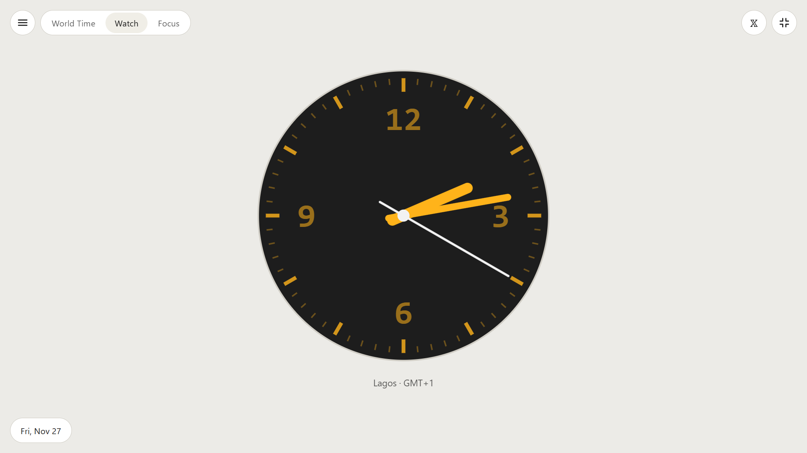
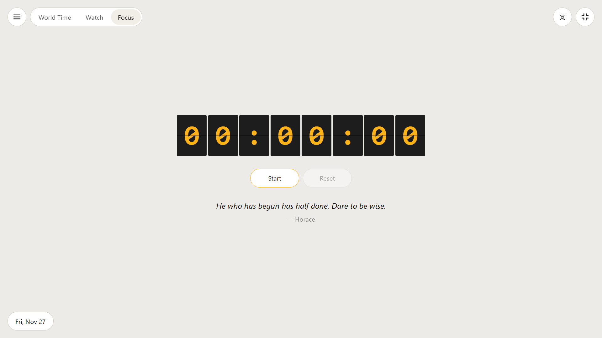

# zoneboard


A split-flap departure board for world time zones, with an analogue watch and a focus stopwatch.

**Live app:** https://zoneboard-nathani.vercel.app


| Watch | Focus |
|---|---|
|  |  |

## Privacy

Your city list, theme choice and the last Focus quote shown are saved only in your own browser (`localStorage`). They are never sent to a server, and there are no accounts, cookies or analytics. Clearing your browser's site data resets everything.

## Features

**Three modes**, each with its own link: [World Time](https://zoneboard-nathani.vercel.app/#world), [Watch](https://zoneboard-nathani.vercel.app/#watch) and [Focus](https://zoneboard-nathani.vercel.app/#focus). The browser's Back button moves between them.

**World Time**
- Split-flap board with live 24-hour times and GMT offsets, updated on the minute
- Scramble animation when tiles change; only the tiles that change animate
- Time zone button at the bottom shows your own zone (e.g. "Lagos · GMT+1") and opens the city search
- Search 152 cities by name or country; ignores case and accents ("bogota" finds Bogotá)
- Add up to 8 cities, remove them with ×, and the board is remembered on your next visit

**Watch**
- An analogue clock for your own time zone, in the board's amber and charcoal
- Ticks once a second, and only while it's on screen

**Focus**
- A stopwatch on large flap tiles, with Start / Pause / Resume and Reset
- Keeps timing while you look at another mode
- A short quote underneath that's different on every visit

**Everywhere**
- Today's date in your own date format
- Menu with a System / Light / Dark theme switch (remembered, no flash on load)
- Full-screen button for leaving it up on a second screen
- Summer time, half- and quarter-hour offsets (India, Nepal, Newfoundland) and renamed zones (Kolkata, Kyiv) handled correctly
- Turns animation off for visitors with **reduce motion** switched on
- Keyboard and screen-reader friendly

## Run locally

You need [Node.js](https://nodejs.org) 26.

```
git clone https://github.com/Nathani21/zoneboard.git
cd zoneboard
npm install
npm run dev
```

Then open http://localhost:5173.

## Run tests

```
npm test
```

172 tests with [Vitest](https://vitest.dev). CI runs the tests and a type-checked build on every pull request.

## How it works

The logic is split into small, pure TypeScript modules with no access to the page, so every one of them can be unit-tested:

| File | What it does |
|---|---|
| `src/zones.ts` | Times, dates, clock readings and offsets for any IANA time zone, using the browser's `Intl` API (no hard-coded offsets) |
| `src/board.ts` | Board rows, character tiles, adding and removing cities |
| `src/scramble.ts` | Which character each tile shows on each animation frame (randomness is passed in, so tests are repeatable) |
| `src/cities.ts` | The list of 152 searchable cities |
| `src/search.ts` | Ranked, accent-insensitive city search, and what the search box should say |
| `src/home.ts` | The visitor's own time zone as "City · GMT±n", including renamed zones |
| `src/modes.ts` | The three modes and which one a URL asks for |
| `src/watch.ts` | Clock-hand angles and positions on the watch face |
| `src/stopwatch.ts` | The stopwatch as plain data: start, pause, elapsed time (the current time is passed in) |
| `src/quotes.ts` | The Focus quotes, and picking one that wasn't shown last time |
| `src/storage.ts` | Saving the board and theme choice, and validating them on load (saved data is treated as untrusted) |
| `src/ui/` | The only code that touches the page: one file per piece (`board-view.ts`, `search-box.ts`, `top-bar.ts`, `bottom-bar.ts`, `mode-tabs.ts`, `mode-controller.ts`, `watch-view.ts`, `focus-view.ts`, `menu-items.ts`, `theme-switch.ts`, `icons.ts`), plus `local-storage.ts` (storage that never crashes the app) |
| `src/main.ts` | Wires the pieces together and runs the clock |

No framework: plain TypeScript, built with [Vite](https://vite.dev) and hosted on [Vercel](https://vercel.com).

## Roadmap

- Optional flap sound
- ESLint alongside the strict TypeScript checks
- Installable as an app (web app manifest)
- More cities, and alternative names ("Saigon", "Bombay")

## Credits

Inspired by a departure-board world clock I saw on Threads. The design, code and city data here are my own. Focus quotes are short public-domain lines, credited to their authors.

Made by [@NoobLabs_21](https://x.com/NoobLabs_21).

## License

[MIT](LICENSE)